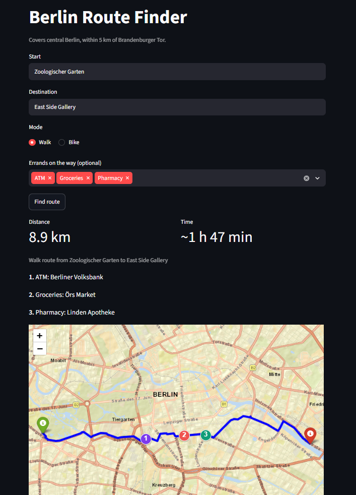

# Berlin Route Finder


Plans the shortest walk home through all your errands, on Berlin's real street network. Pick a start, a destination and what you need (a pharmacy, groceries, an ATM...), and it chooses which shops to visit and in what order.

**Try it:** [berlin-route-finder.streamlit.app](https://berlin-route-finder.streamlit.app)



*Zoologischer Garten → East Side Gallery with an ATM, groceries and a pharmacy on the way.*

## Why I built this

On my way home from uni, I usually have a few things to do, like dropping off a parcel, grabbing something from the pharmacy or buying groceries. Google Maps can route me through all of them, but I have to pick which post office, which pharmacy and which supermarket myself, one by one. And picking the nearest one each time isn't always the best plan for the whole trip:


With the same shops to choose from and the same start and end, always taking the nearest one gives 10.4 km, while the best combination is 8.7 km. The catch is that the number of possible trips explodes. With 6 errands and 5 shops each, there are over 11 million. In research, this is known as the [Trip Planning Query](https://doi.org/10.1007/11535331_16) (Li et al., 2005).

## How it works

The planner splits the problem into two parts, finding good candidates and choosing the best trip among them.

**Candidates.** For each kind of errand, it keeps the 5 shops with the smallest straight-line detour between start and end, then computes the real walking distances between all of them with A* on the OpenStreetMap street graph. Narrowing down first keeps the number of routes small, at the cost of sometimes missing a better shop.

**Choosing the trip.** The best combination and order are found with dynamic programming (the Held–Karp algorithm). A partial trip is described by which errands are done and where you are. If two partial trips end at the same shop with the same errands done, only the shorter one can lead to the best trip, so the other is dropped. This turns 11 million possible trips into about 2,000 states.

## Results


- **6 errands, 11 million possible trips, planned in about 2 seconds**, because dynamic programming never builds them all.
- **Errands barely add distance:** going straight from TU Berlin to Alexanderplatz is about 6.2 km, and with a post office, a pharmacy and groceries the best trip is 6.67 km.
- **Routing is over 10,000× faster** than my first version on short routes (71 s → 0.002 s).

All measurements and how to reproduce them are in [docs/benchmarks.md](docs/benchmarks.md).

## Run locally

```bash
git clone https://github.com/ArvellLeoputra/berlin-route-finder.git
cd berlin-route-finder
python3 -m venv .venv
source .venv/bin/activate
pip install -r requirements.txt
streamlit run app.py
```

`pytest` runs 14 tests (routing distances, A* against Dijkstra, the planner against trying every trip). They also run on every push with GitHub Actions.

## Project structure

```
app.py                 Streamlit app (entry point)
src/
  routing.py           graph helpers, nearest-intersection index, A* routing, map
  planner.py           errand planner: shortlist and dynamic programming
  config.py            covered area (center and radius)
  build_graph.py       downloads and saves the street graphs
  build_shops.py       downloads and saves the shops
benchmarks/            timing scripts and the errands chart
tests/                 pytest tests
data/                  street graphs (.graphml.gz) and shops (shops.csv)
images/                screenshots, figures and charts
docs/                  this file
```

## Limitations and next steps

- It covers 5 km around Brandenburger Tor, and travel time uses average speeds.
- The shortlist can miss the best shop.Next: an exact planner without a shortlist, to measure how often that happens.
- Shop data comes from OpenStreetMap, so some shops have no name and opening hours are ignored. Next: skip closed shops, and order rules like "groceries last".

## Data

Street and shop data © OpenStreetMap contributors, available under the Open Database License.