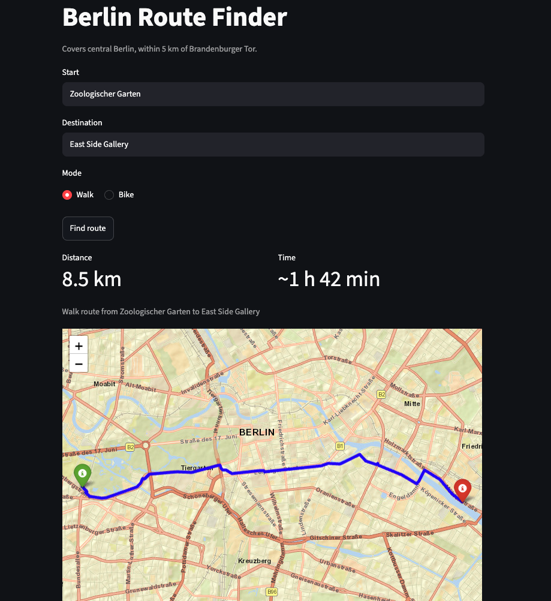
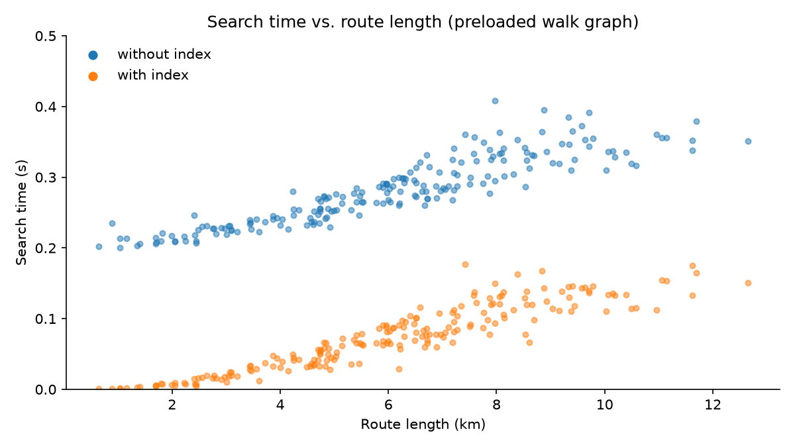

# Berlin Route Finder


Shortest walking and cycling routes on Berlin's real street network, computed on OpenStreetMap data and shown on an interactive map.

**Live:** https://berlin-route-finder.streamlit.app



The first version downloaded streets for every search and took over a minute per query. The current version loads the walk and bike graphs and their nearest-intersection indexes once at startup (about 9 seconds in total on a 2021 MacBook Pro with an M1 Pro chip).

After that, a search takes a few milliseconds for short routes and up to about 0.2 seconds for the longest ones in the covered area.

## How it got faster

| Version | What changed | Why |
|---|---|---|
| Live download | Fetched the streets around each search from the Overpass API | Easy to build, but every search took over a minute and broke when the server was busy |
| Caching | Cached geocoding results and graphs in memory | Searching the same route again is faster |
| Preloaded graphs | Built the walk and bike networks (5 km around Brandenburger Tor) once and loaded them at startup | Searches no longer download street data |
| Compression | Stored the graphs as `.graphml.gz` | 89 MB → 9.7 MB (walk), 40 MB → 4.7 MB (bike), small enough to ship with the repo |
| Prebuilt index | Built the nearest-intersection lookup once at startup instead of on every search | OSMnx prepared its lookup from scratch on each call, a fixed cost of about 0.2 s per search |
| Single search | Took the route and its length from one bidirectional search instead of two | The length came from a second, one-directional Dijkstra search; now both come from the search that finds the route |

## Results

| Route | Distance | Live download (first version) | Now | Speedup |
|---|---|---|---|---|
| Brandenburger Tor → Potsdamer Platz | 865 m | ~71 s | 0.002 s | >10,000× |
| Hauptbahnhof → Alexanderplatz | 3.6 km | ~66 s | 0.030 s | ~2,200× |
| Zoologischer Garten → East Side Gallery | 8.5 km | ~114 s | 0.144 s | ~800× |

Walking routes, measured locally on a MacBook Pro (M1 Pro, 16 GB RAM), Python 3.13, OSMnx 2.1.1. Timings cover the nearest-intersection lookup and the path search, not the geocoding of place names.

Now: time per search after startup, best of 5 runs (`benchmarks/benchmark.py`). Startup happens once: the walk graph (90,663 intersections) loads in 5.8 s and its index builds in 0.07 s. The bike graph (37,980 intersections) loads in 3.0 s and its index builds in 0.03 s.

Live download: total time per search (download + routing), measured once per route on a MacBook Air M3 (`benchmarks/benchmark_live.py`). These times depend mainly on the load of the public Overpass server, not on the laptop.

All versions find the same routes. The download was almost all of the original cost: routing itself took under 0.4 s there too.



The same 200 random routes, each timed best of 3, with and without the index (`benchmarks/benchmark_scaling.py`). Without it, every search pays a fixed cost of about 0.2 s, because OSMnx prepares its lookup over all 90,663 intersections from scratch on each call. Building it once removes that cost, so short routes now take a few milliseconds. What remains is the path search itself, which grows with route length, up to about 0.17 s for 12 km. Across the 200 routes, the mean search time is 0.28 s without the index and 0.07 s with it.

## Tests

Run `pytest` to run 5 tests. They check known route distances (865 m, 3.6 km, 8.5 km), and that the fast nearest-intersection index gives the same result as OSMnx.

## How it works

- **Graph:** OSMnx turns OpenStreetMap data into a directed graph. The walk network has 90,663 intersections, the bike network 37,980.
- **Geocoding:** place names are resolved with Nominatim and checked against the covered area.
- **Routing:** start and end snap to the nearest intersection using a BallTree built once at startup, then a bidirectional Dijkstra search in NetworkX finds the shortest path and its length in one pass, weighted by street length.
- **App:** Streamlit, with the graphs and indexes loaded at startup and the route kept in session state so it survives Streamlit's reruns.

## Project structure

```
app.py                 Streamlit app (entry point)
src/
  routing.py           graph helpers, nearest-intersection index, routing, map
  config.py            covered area (center and radius)
  build_graph.py       downloads and saves the street graphs
benchmarks/            timing scripts
tests/                 pytest tests
data/                  preloaded street graphs (.graphml.gz)
images/                screenshot and benchmark chart
```

## Limitations

- Only covers places within 5 km of Brandenburger Tor.
- Travel time uses average speeds (5 km/h walking, 15 km/h cycling).
- Snapping to the nearest intersection isn't always optimal: a slightly farther entry point can give a shorter total route.
- The live app runs on a free server, so its startup is likely slower than the laptop numbers above, and it goes to sleep when nobody uses it for a while.

## What's next

- Try A* search, which uses the straight-line distance to the destination as a guide and could explore even fewer intersections.
- Smarter snapping that considers several nearby intersections, not just the closest one.
- A multi-stop tour that finds the best order to visit several places.

## Run locally

```bash
git clone https://github.com/ArvellLeoputra/berlin-route-finder.git
cd berlin-route-finder
python3 -m venv .venv
source .venv/bin/activate
pip install -r requirements.txt
streamlit run app.py
```

To rebuild the street graphs: `python -m src.build_graph`.

To reproduce the timings: `python -m benchmarks.benchmark`, `python -m benchmarks.benchmark_live` and `python -m benchmarks.benchmark_scaling`.

To run the tests: `pytest`