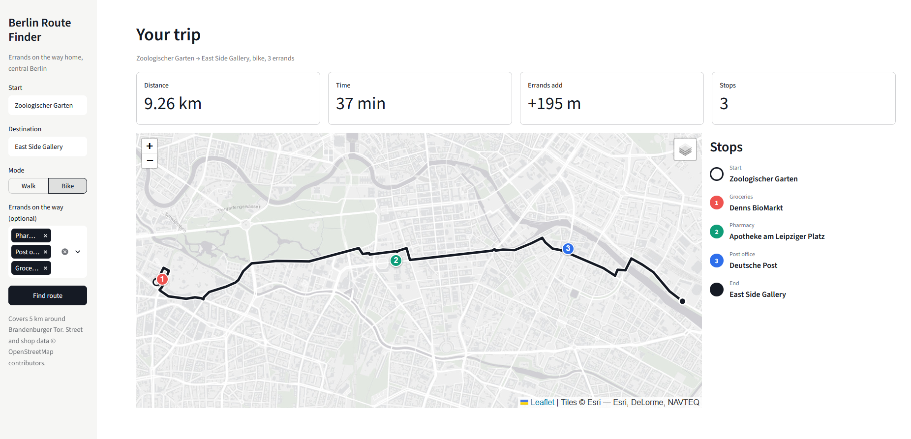
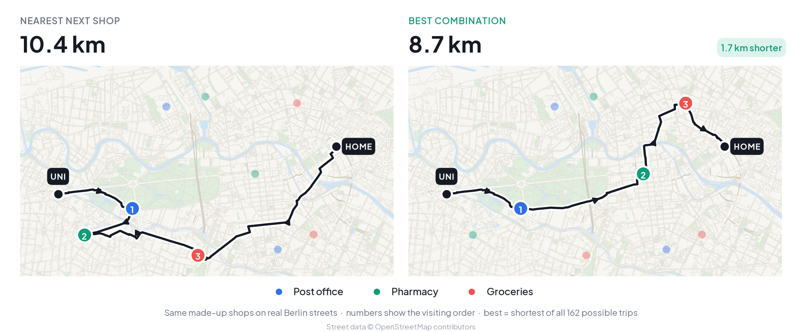

# Berlin Route Finder


Plans the shortest walk home through all your errands, on Berlin's real street network. Pick a start, a destination and what you need (a pharmacy, groceries, an ATM...), and it chooses which shops to visit and in what order.

**Try it:** [berlin-route-finder.streamlit.app](https://berlin-route-finder.streamlit.app)



*Zoologischer Garten → East Side Gallery with an ATM, groceries and a pharmacy on the way.*

## Why I built this

On my way home from uni, I usually have a few things to do, like dropping off a parcel, grabbing something from the pharmacy or buying groceries. Google Maps can route me through all of them, but I have to pick which post office, which pharmacy and which supermarket myself, one by one. And picking the nearest one each time isn't always the best plan for the whole trip:



With the same shops to choose from and the same start and end, always taking the nearest one gives 10.4 km, while the best combination is 8.7 km. The catch is that the number of possible trips explodes. With 6 errands, even with only 5 shops of each kind to choose from, there are over 11 million. In research, this is known as the [Trip Planning Query](https://doi.org/10.1007/11535331_16) (Li et al., 2005).

## How it works

The planner searches the street map with A*, but each position also remembers which errands are already done. Walking a street costs its length, and standing at a shop of a missing kind ticks that errand off for free. The search stops the first time it reaches home with every errand done, and that trip is guaranteed to be the shortest. The straight-line distance to home guides the search, so it stays near the way home. From TU Berlin to Alexanderplatz with all 6 errands, it reaches only about 7% of the intersections and 6% of the shops.

### My first approach, a shortlist

At first, the planner kept only the 5 shops of each kind with the smallest straight-line detour, measured the walks between them, and combined them with dynamic programming (the Held–Karp algorithm). It was fast, but when I compared it with the exact search on random trips, it often missed the best trip, so the app now uses the exact search.

## Results

Exact search vs shortlist on 40 random trips, MacBook Pro with M1 Pro chip:

| Errands | Planner | Best trip found | Average extra | Worst miss | Time (mean / max) |
|---|---|---|---|---|---|
| 3 | Exact search | 40 of 40 | 0 % | 0 m | 0.25 s / 0.85 s |
| 3 | Shortlist | 17 of 40 | 0.8 % | 542 m | 0.50 s / 2.01 s |
| 6 | Exact search | 40 of 40 | 0 % | 0 m | 1.98 s / 7.88 s |
| 6 | Shortlist | 10 of 40 | 1.5 % | 555 m | 1.79 s / 7.86 s |

- **The exact search always finds the shortest trip**, and is twice as fast as the shortlist with 3 errands and about as fast with 6.
- **Errands barely add distance.** Going straight from TU Berlin to Alexanderplatz is about 6.2 km, and with a post office, a pharmacy and groceries the best trip is 6.43 km.
- **Routing is over 10,000× faster** than my first version on short routes (71 s → 0.002 s).

All measurements and how to reproduce them are in [docs/benchmarks.md](docs/benchmarks.md).

## Run locally

```bash
git clone https://github.com/ArvellLeoputra/berlin-route-finder.git
cd berlin-route-finder
python3 -m venv .venv
source .venv/bin/activate
pip install -r requirements.txt
streamlit run app.py
```

`pytest` runs 18 tests (routing distances, A* against Dijkstra, both planners against known best trips, the exact search never worse than the shortlist). They also run on every push with GitHub Actions.

## Project structure

```
app.py                 Streamlit app (entry point)
src/
  routing.py           graph helpers, nearest-intersection index, A* routing, map
  exact.py             errand planner: exact search over (intersection, errands done)
  planner.py           first planner: shortlist and dynamic programming
  config.py            covered area (center and radius)
  build_graph.py       downloads and saves the street graphs
  build_shops.py       downloads and saves the shops
benchmarks/            timing scripts and the errands chart
tests/                 pytest tests
data/                  street graphs (.graphml.gz) and shops (shops.csv)
images/                screenshots, figures and charts
docs/                  detailed benchmarks
```

## Limitations and next steps

- It covers 5 km around Brandenburger Tor, and travel time uses average speeds.
- Each extra errand doubles the work of the exact search. With all 6 errands it takes about 2 seconds on average, but up to 8 seconds on long trips.
- Shop data comes from OpenStreetMap, so some shops have no name and opening hours are ignored. Next: skip closed shops, and order rules like "groceries last".

## Data

Street and shop data © OpenStreetMap contributors, available under the Open Database License.