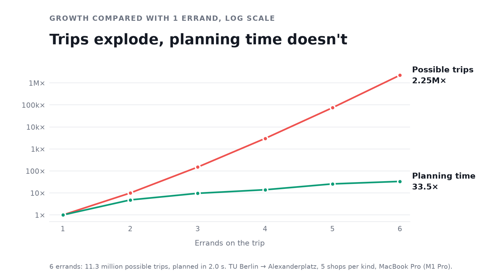

# Benchmarks

All timings were measured on a MacBook Pro (M1 Pro, 16 GB RAM) with Python 3.13 and OSMnx 2.1.1, for walking routes, unless noted otherwise. Each section names the script that reproduces it.

## Planner

### More errands

`benchmarks/benchmark_planner.py`: TU Berlin → Alexanderplatz, 5 shops per kind, errands added in the order post office, pharmacy, groceries, bakery, ATM, drugstore.



| Errands | Possible trips | Best trip found | Time |
|---|---|---|---|
| 1 | 5 | 6.36 km | 0.06 s |
| 2 | 50 | 6.36 km | 0.29 s |
| 3 | 750 | 6.67 km | 0.58 s |
| 4 | 15,000 | 6.68 km | 0.84 s |
| 5 | 375,000 | 6.68 km | 1.55 s |
| 6 | 11,250,000 | 6.68 km | 2.01 s |

The number of possible trips explodes, but the planning time barely grows, because dynamic programming never builds them all. Most of the time goes into the walking routes between the shortlisted shops. Going straight home is about 6.2 km. Bakeries, ATMs and drugstores are so common that there's almost always one right on the way, so errands 4 to 6 add only about 10 m.

### Shortlist size

Same script, with a post office, a pharmacy and groceries.

| Shortlist per kind | Possible trips | Best trip found | Time |
|---|---|---|---|
| 3 | 162 | 6.85 km | 0.20 s |
| 5 | 750 | 6.67 km | 0.61 s |
| 8 | 3,072 | 6.67 km | 1.57 s |
| 10 | 6,000 | 6.64 km | 2.73 s |

The shortlist is a heuristic. A shop that looks like a detour in a straight line can still have a direct street, so a small shortlist can miss the best trip. A bigger one is safer but slower. The app uses 5 shops per kind.

## Routing

### How it got faster

| Step | What changed | Why |
|---|---|---|
| Live download | Fetched the streets around each search from the Overpass API | Easy to build, but every search took over a minute and broke when the server was busy |
| Caching | Cached geocoding results and graphs in memory | Searching the same route again is faster |
| Preloaded graphs | Built the walk and bike networks (5 km around Brandenburger Tor) once and loaded them at startup | Searches no longer download street data |
| Compression | Stored the graphs as `.graphml.gz` | 89 MB → 9.7 MB (walk), 40 MB → 4.7 MB (bike), small enough to ship with the repo |
| Prebuilt index | Built the nearest-intersection lookup (a BallTree) once at startup | OSMnx prepared its lookup from scratch on each call, a fixed cost of about 0.2 s per search |
| Single search | Took the route and its length from one bidirectional search instead of two | The length came from a second, one-directional Dijkstra search |
| A* search | Replaced the bidirectional search with A*, guided by the straight-line distance to the destination | Checks fewer intersections, and since the guide never overestimates, so the routes stay the same |

### First version vs now

`benchmarks/benchmark.py` and `benchmarks/benchmark_live.py`

| Route | Distance | First version | Now | Speedup |
|---|---|---|---|---|
| Brandenburger Tor → Potsdamer Platz | 865 m | ~71 s | 0.002 s | >10,000× |
| Hauptbahnhof → Alexanderplatz | 3.6 km | ~66 s | 0.030 s | ~2,200× |
| Zoologischer Garten → East Side Gallery | 8.5 km | ~114 s | 0.144 s | ~800× |

- **Now:** time per search with the bidirectional search, after startup, best of 5 runs. It covers the nearest-intersection lookup and the path search, not the geocoding of place names.
- **Startup** happens once: the walk graph (90,663 intersections) loads in 5.8 s and its index builds in 0.07 s; the bike graph (37,980 intersections) loads in 3.0 s and its index builds in 0.03 s.
- **First version:** total time per search (download + routing), measured once per route on a MacBook Air M3. These times depend mainly on the load of the public Overpass server, not on the laptop. Routing itself took under 0.4 s, so the download was almost all of the cost.
- All versions find the same routes.

### A* vs bidirectional search

`benchmarks/benchmark_astar.py`: best of 5 runs, speedups from unrounded times.

| Route | Distance | Bidirectional | A* | Speedup |
|---|---|---|---|---|
| Brandenburger Tor → Potsdamer Platz | 865 m | 0.002 s | 0.001 s | 2.7× |
| Hauptbahnhof → Alexanderplatz | 3.6 km | 0.031 s | 0.009 s | 3.5× |
| Zoologischer Garten → East Side Gallery | 8.5 km | 0.148 s | 0.062 s | 2.4× |

A* uses the straight-line distance to the destination as a guide, so it checks fewer intersections. The guide is never longer than the real distance, so A* finds the same shortest routes, and the tests check this. The app uses A*.

### Search time vs route length

`benchmarks/benchmark_scaling.py`, measured with the bidirectional search.


The same 200 random routes, each timed best of 3, with and without the prebuilt index. Without it, every search pays a fixed cost of about 0.2 s, because OSMnx prepares its lookup over all 90,663 intersections from scratch on each call. Building it once removes that cost, so short routes now take a few milliseconds. What remains is the path search itself, which grows with route length, up to about 0.17 s for 12 km. Across the 200 routes, the mean search time is 0.28 s without the index and 0.07 s with it.

## Reproduce

```bash
python -m benchmarks.benchmark           # startup and search times
python -m benchmarks.benchmark_live      # the first version (needs internet)
python -m benchmarks.benchmark_scaling   # the 200-route chart
python -m benchmarks.benchmark_astar     # A* vs bidirectional search
python -m benchmarks.benchmark_planner   # planner: more errands, shortlist sizes
python -m benchmarks.plot_errands        # the errands chart
```

To download the data again (needs internet): `python -m src.build_graph` for the street graphs and `python -m src.build_shops` for the shops.